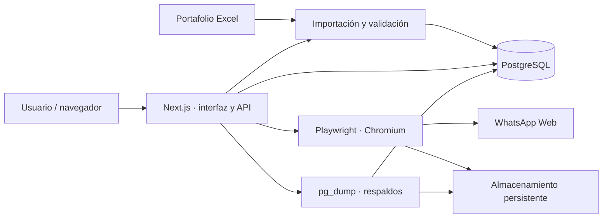

<p align="center">
  
</p>

# Gestión de Oficina · Estudio Caillaux

Sistema interno para administrar una cartera de clientes y créditos, registrar
gestiones de cobranza, seguir promesas de pago y consultar la actividad del
equipo. Centraliza la información del portafolio en PostgreSQL y permite
actualizarla desde Excel conservando el historial de trabajo.

La aplicación puede ejecutarse en desarrollo local o mediante su imagen Docker.
La configuración del servicio, la base de datos y el dominio en Azure se realiza
en el entorno de destino.

**Accesos rápidos:** [Instalación con Docker](#instalación-con-docker) ·
[Desarrollo local](#desarrollo-local) ·
[Importación de portafolios](#importación-de-portafolios) ·
[Azure](#despliegue-en-azure) · [Guía Docker completa](DOCKER.md)

## Funcionalidades

| Módulo | Qué permite hacer |
| --- | --- |
| Clientes y productos | Buscar clientes y consultar créditos, garantías, datos generales, teléfonos, direcciones e historial. |
| Gestiones | Registrar tipificaciones, segmentación, observaciones y montos pagados; consultar y exportar la actividad. |
| Promesas de pago | Registrar compromisos y cambiar su estado conservando sus detalles, según los permisos del usuario. |
| Monedas | Mostrar importes y totales separados en soles y dólares; identificar la moneda de cada garantía. |
| Portafolios | Importar cuentas, teléfonos, garantías y apersonamientos desde Excel; revisar el resultado y el historial de importaciones. |
| Dashboard | Consultar indicadores, tendencias, promesas y actividad por fechas y gestores. |
| WhatsApp | Preparar campañas, revisar mensajes, enviar mediante WhatsApp Web y consultar su historial. |
| Usuarios | Administrar cuentas y roles, con cambio obligatorio de la contraseña inicial. |
| Backups | Crear y descargar respaldos de PostgreSQL, además de los respaldos programados. |

El formulario de gestión ofrece **«Ninguno»** y **«No se llamó»** aunque el
cliente tenga teléfonos. También permite registrar **TAT, MCT o TIN** con la
razón en **«Ninguno»**. Estas selecciones se conservan en el historial y las
exportaciones.

## Arquitectura y tecnologías

La interfaz y las rutas API forman una aplicación Next.js. La lógica de negocio
y el acceso a PostgreSQL están en `lib/`; WhatsApp utiliza un navegador Chromium
controlado por Playwright.



| Componente | Tecnología |
| --- | --- |
| Aplicación | Next.js 16, React 19 y TypeScript |
| Interfaz | Tailwind CSS 4, Recharts y Framer Motion |
| Base de datos | PostgreSQL 18 y cliente `pg` |
| Autenticación | JWT mediante `jose`, cookies de sesión y contraseñas con hash mediante `bcryptjs` |
| Excel | ExcelJS |
| WhatsApp | Playwright y Chromium |
| Respaldos programados | `node-cron` y `pg_dump` |
| Contenedor | Node.js 24, imagen Linux y Docker Compose |

Las versiones concretas de las dependencias se resuelven con
[`package-lock.json`](package-lock.json). Los roles disponibles son
**administrador**, **supervisor**, **abogado** y **gestor**. El acceso a los
paneles, clientes y operaciones se comprueba según el rol y la cartera asignada;
la administración de usuarios corresponde al administrador.

## Instalación con Docker

Para una instalación nueva, sigue [la guía Docker](DOCKER.md#primera-ejecución-en-local).
Necesitas Git y Docker Desktop iniciado en modo de contenedores Linux.

```powershell
git clone https://github.com/alejandro-javier-ds/gestion-oficina.git
cd gestion-oficina
if (!(Test-Path .env.docker)) { Copy-Item docker/environment.example .env.docker }
```

Completa `.env.docker` con tres secretos diferentes siguiendo la guía. Después,
realiza la preparación en este orden:

1. Compilar la imagen y levantar la base de datos de Docker.
2. Ejecutar `init-db` sobre esa base vacía.
3. Ejecutar `create-admin` con los datos del primer administrador.
4. Arrancar la aplicación, iniciar sesión y cambiar la contraseña inicial.
5. Importar el portafolio desde el panel.

La guía incluye los comandos completos y la solicitud de contraseña sin
mostrarla en pantalla. **No existe un administrador ni una contraseña
predeterminados.** `init-db` se detiene si encuentra tablas; `create-admin` solo
funciona mientras no existan usuarios. Ninguno se ejecuta automáticamente al
arrancar la aplicación.

| Configuración | Uso |
| --- | --- |
| [`compose.yaml`](compose.yaml) | Aplicación conectada a una base de datos externa. |
| [`compose.local.yaml`](compose.local.yaml), junto con el anterior | Añade PostgreSQL 18 en Docker, con su propio volumen, sin publicar el puerto 5432. |
| [`docker/environment.example`](docker/environment.example) | Plantilla de variables sin credenciales, para copiar a `.env.docker`. |

Con los valores predeterminados, la aplicación de Docker abre en
**[http://localhost:3001](http://localhost:3001)**. Esta configuración permite
mantener el desarrollo en el puerto 3000 y conserva el PostgreSQL instalado en
Windows sin utilizar sus archivos ni su servicio.

## Desarrollo local

Esta opción utiliza una base PostgreSQL **ya preparada**, con el esquema y al
menos un usuario. Para crear un entorno desde cero, utiliza la instalación con
Docker descrita arriba.

Requisitos: Node.js 24, npm, acceso a PostgreSQL 18 y, para los respaldos,
`pg_dump` disponible en el sistema. Instala las dependencias desde el lockfile:

```powershell
npm ci
```

Configura un archivo `.env.local` en la raíz con los valores de tu entorno:

```dotenv
DATABASE_URL=
JWT_SECRET=
```

`DATABASE_URL` es la cadena de conexión a esa base. `JWT_SECRET` es un secreto
propio para firmar las sesiones; puedes generarlo con:

```powershell
node -e "console.log(require('node:crypto').randomBytes(32).toString('hex'))"
```

Para utilizar WhatsApp en desarrollo, instala el navegador de Playwright:

```powershell
npx playwright install chromium
```

Inicia la aplicación:

```powershell
npm run dev
```

Abre **[http://localhost:3000](http://localhost:3000)**. Next.js carga
`.env.local`; ese archivo permanece fuera de Git y de la imagen Docker.

| Comando | Uso |
| --- | --- |
| `npm run dev` | Servidor de desarrollo. |
| `npm run lint` | Revisión del código con ESLint. |
| `npm run build` | Compilación de producción. |
| `npm start` | Ejecutar una compilación de producción realizada previamente. |

Las pruebas se conservan en local y están excluidas por los archivos ignore.

## Importación de portafolios

Desde **Subir Portafolio**, selecciona un archivo `.xlsx`. Los encabezados deben
estar en la primera fila. La hoja **Cuentas** es obligatoria; las demás se
procesan cuando están presentes.

| Hoja | Campos obligatorios que el importador debe reconocer |
| --- | --- |
| `Cuentas` | `CODCUENTACOBRANZA`, `IDC`, `CLIENTE`, `FUNCIONARIO` |
| `Telefonos` | `id_phone`, `customer_id`, `phone` |
| `Garantias` | `GAR_CODIGO`, `IDC` |
| `Apersonamiento` | `IDC` |

El importador normaliza mayúsculas, acentos, espacios y signos en los nombres de
hojas y columnas. Reconoce los alias definidos en
[`lib/portafolio-excel.ts`](lib/portafolio-excel.ts), por lo que las columnas
pueden cambiar de posición y se pueden añadir columnas adicionales.

Cuando ya existe información importada, también puede reconocer algunos
encabezados cambiados por coincidencias entre el contenido y los registros
anteriores. Los cambios de nombre de responsables pueden reconocerse por la
continuidad de las cuentas. Esto depende de que haya suficientes coincidencias:
**no admite automáticamente cualquier encabezado o contenido parecido**. En una
base nueva, utiliza nombres o alias reconocidos.

Cada importación:

- Agrega cuentas nuevas y actualiza las existentes mediante su código.
- Marca como inactivas las cuentas que dejan de aparecer en la cartera
  reconocida, conservando su historial de gestiones.
- Conserva los campos opcionales de cuentas existentes cuando sus columnas no
  vienen en el nuevo archivo.
- Mantiene los datos de las hojas opcionales que no se incluyan y los teléfonos
  agregados manualmente.
- Aplica los filtros de cartera configurados y muestra un resumen e historial.

Si falta un campo obligatorio o el mapeo resulta ambiguo, la importación se
rechaza con un mensaje de error. Las operaciones de las hojas se ejecutan en
una sola transacción: un fallo revierte los cambios de esa importación.

## WhatsApp y respaldos

WhatsApp utiliza sesiones persistentes de Chromium. **Agregar número** guarda el
teléfono y su propietario en el selector sin exigir la vinculación. Para enviar
desde él, un administrador o supervisor debe pulsar **Vincular WhatsApp** o
**Abrir WhatsApp**: el QR aparece directamente dentro del CRM, se actualiza y
desaparece al detectar **Conectado**. La sesión guardada se reutiliza mientras
WhatsApp mantenga la vinculación.

El QR se entrega mediante una API protegida sin caché y no se guardan capturas
de conversaciones. No se necesita publicar VNC ni otro puerto para escanearlo.
Consulta [WhatsApp y el QR](DOCKER.md#whatsapp-y-el-qr) para los pasos y los
requisitos de permisos, enlaces simbólicos y bloqueo de perfiles en Azure Files.

Los respaldos se crean con `pg_dump` y se pueden descargar desde el panel de
Backups. El programador realiza respaldos los **lunes y jueves a las 17:00, hora
de Lima**, mientras el proceso de la aplicación esté en ejecución. Los volúmenes
de Compose conservan la base, los respaldos y las sesiones al recrear el
contenedor; consulta [persistencia y operación](DOCKER.md#persistencia-y-operación).

En Azure Container Apps, cada respaldo manual o programado también se copia a
`stgestionescaillaux`, dentro del contenedor privado `backups-postgresql`. El
archivo original permanece en `/app/backups` sobre Azure Files y se mantiene la
rotación local de los últimos 30 respaldos. La aplicación no elimina copias de
Blob Storage ni carga automáticamente los respaldos anteriores a este cambio.

La copia utiliza la identidad administrada del sistema del Container App con
el rol **Storage Blob Data Contributor**, sin claves de almacenamiento ni SAS.
Si se usa una identidad administrada asignada por el usuario, `AZURE_CLIENT_ID`
debe contener su identificador de cliente; no es una clave ni una contraseña.
Azure proporciona `IDENTITY_ENDPOINT` e `IDENTITY_HEADER`; no se deben guardar
en Git ni configurarlos manualmente. Este flujo sigue la
[autenticación con identidad administrada de Container Apps](https://learn.microsoft.com/en-us/azure/container-apps/managed-identity).

Cada archivo tiene un nombre único. La carga comprueba tamaño y huella SHA-256
para reconocer copias existentes, y usa una condición de creación para impedir
sobrescrituras y duplicados al reintentar. Las llamadas simultáneas para un mismo
archivo comparten la carga en curso. El SDK reintenta fallos transitorios; las
operaciones de copia reciben una señal de cancelación a los dos minutos y cada
petición al servicio de identidad tiene un límite de diez segundos.

Si la identidad o Blob Storage fallan, el respaldo sigue disponible en el panel
y se registra `[backup Blob]` con el nombre, el código de error y el estado HTTP
cuando existe. No se registran tokens ni credenciales. Fuera de Azure, sin
identidad administrada, el respaldo local se crea y se registra que la copia a
Blob no está disponible. Tras agotar los reintentos, no hay una cola persistente
de cargas pendientes; el archivo local se conserva sujeto a su rotación habitual.

## Despliegue en Azure

La imagen contiene la aplicación compilada, Chromium y el cliente PostgreSQL 18.
Se ejecuta con el usuario `node` y escucha en `0.0.0.0:3000`. Puedes utilizarla
en un servicio de Azure que permita ejecutar este contenedor Linux y configurar
sus recursos y almacenamiento.

| Elemento | Configuración en el entorno de destino |
| --- | --- |
| Tráfico | Dirigir las peticiones al puerto 3000 del contenedor y servir el dominio por HTTPS. |
| Base de datos | Definir `DATABASE_URL` para PostgreSQL con TLS y acceso desde la aplicación. |
| Sesiones | Definir un `JWT_SECRET` propio como variable de ejecución. |
| Primera instalación | Ejecutar `init-db` si la base está vacía y después `create-admin`, proporcionando `BOOTSTRAP_ADMIN_*` únicamente para ese comando. |
| Persistencia | Montar `/app/backups`, `/app/whatsapp-sessions` y `/app/.whatsapp-sesiones`, con escritura para UID 1000. |
| Chromium | Disponer de memoria compartida equivalente a `shm_size: 1gb`; el QR se muestra en el CRM sin habilitar el visor. Azure Files debe permitir enlaces simbólicos y bloqueos entre clientes. |
| Instancias | Mantener una instancia mientras las sesiones de WhatsApp y los respaldos programados se administren dentro del proceso. |

La comprobación de salud usa `127.0.0.1` para consultar la aplicación **dentro del
mismo contenedor** y verificar la base. El dominio público se configura en Azure;
no reemplaza esa dirección interna.

El workflow [`.github/workflows/docker.yml`](.github/workflows/docker.yml)
compila la imagen y comprueba las herramientas incluidas en los pushes y pull
requests. **La publicación de la imagen y el despliegue en Azure se configuran
por separado**: el workflow actual no realiza esas acciones.

Consulta [Usar la misma imagen en Azure](DOCKER.md#usar-la-misma-imagen-en-azure)
para los detalles de operación.

## Estructura del repositorio

```text
app/                   Páginas, layouts y rutas API
components/            Interfaz de clientes, gestiones, dashboard y WhatsApp
hooks/                 Estado y flujos de la interfaz de WhatsApp
lib/                   Lógica, autenticación, importadores y acceso a PostgreSQL
public/                Recursos estáticos y logo de Estudio Caillaux
docker/                Arranque, salud, inicialización y plantilla de variables
scripts/postgres/      Esquemas SQL utilizados en la instalación inicial
.github/workflows/     Validación de la imagen en GitHub Actions
Dockerfile             Construcción de la imagen de producción
compose.yaml           Aplicación con base externa
compose.local.yaml     Entorno Docker local con base independiente
DOCKER.md              Instalación y operación detalladas con Docker
```

## Código y datos privados

El repositorio contiene el código, los esquemas y las plantillas de
configuración. [`.gitignore`](.gitignore) excluye los archivos `.env*`,
portafolios reales, exportaciones, backups, bases locales, sesiones de WhatsApp,
pruebas y archivos generados. [`.dockerignore`](.dockerignore) limita el contexto
de construcción al código y los recursos necesarios.

Mantén las credenciales en las variables de cada entorno. Los archivos de
clientes y los respaldos se administran en el almacenamiento de la aplicación,
fuera del repositorio. La plantilla `docker/environment.example` se publica
con sus campos de secretos vacíos.
