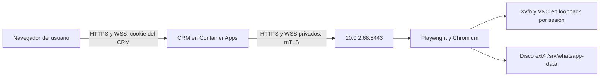

# WhatsApp en la VM de Estudio Caillaux

Esta integración requiere aprobación y despliegue manual. Publicar la rama en GitHub no inicia el servicio de la VM ni cambia Azure Container Apps.

## Arquitectura



El navegador conserva la interfaz y el origen del CRM. El gateway verifica usuario activo, contraseña obligatoria, rol y número al abrir la pantalla, vuelve a comprobarlos después de conectar y los comprueba cada cinco segundos mientras permanece abierta. VNC escucha únicamente en loopback dentro del worker. No se publica VNC, CDP ni un endpoint para descargar perfiles o cookies.

La VM exige TLS 1.3, un certificado cliente válido y su huella SHA-256 permitida. Cada operación incluye una capacidad firmada por la clave cliente que identifica usuario, rol, operación, número y hash del cuerpo; caduca a los 30 segundos y solo se acepta una vez. La VM confía en el CRM para la autorización de números registrados en PostgreSQL; conserva y verifica por separado el propietario de cada sesión temporal. El rol gestor solo puede consultar estados a través del CRM; no obtiene QR, visor ni control.

El transporte mantiene conexiones HTTP persistentes y comprueba su certificado en cada operación. No reutiliza sesiones TLS entre conexiones nuevas, para que cada handshake entregue el certificado completo y permita validar vigencia y SAN sin rechazar conexiones legítimas bajo concurrencia.

Antes de cada envío, el CRM vuelve a leer usuario activo, rol, cambio obligatorio de contraseña y autorización del número. Una revocación durante una campaña impide los siguientes envíos. Una operación que ya comenzó puede haber enviado su mensaje; su resultado se conserva y no se duplica. Un envío bloqueado durante 75 segundos cierra su Chromium y conserva el perfil para recuperación.

`WHATSAPP_BACKEND=remote` impide iniciar Chromium en el CRM, incluso si la VM falla. `local` mantiene el desarrollo existente. El módulo antiguo utiliza el mismo motor y deja de abrir `.whatsapp-sesiones`; esa carpeta y todos los perfiles antiguos se conservan.

Un fallo de la VM o de sus certificados deja WhatsApp sin conexión y muestra error en sus estados. El CRM sigue arrancando, permite registrar números para los tenores y conserva las demás funciones.

## Archivos de la VM

| Ruta | Uso |
| --- | --- |
| `/srv/whatsapp-data/whatsapp-sessions` | Perfiles permanentes |
| `/srv/whatsapp-data/whatsapp-sessions/.temporales` | Perfiles temporales del usuario |
| `/srv/whatsapp-data/sesiones.json` | Propietarios de las sesiones temporales |
| `/srv/whatsapp-data/envios` | Registro duradero para evitar envíos repetidos |
| `/srv/whatsapp-data/runtime` | HOME y temporales del proceso |
| `/srv/whatsapp-data/profile-backups` | Copias de perfiles cifradas y realizadas en frío |
| `/etc/whatsapp-worker/tls` | CA pública, certificado y clave del servidor |
| `/etc/whatsapp-worker/worker.env` | UUID del disco, imagen y huella del cliente |

El contenedor utiliza UID 999 y GID 988, raíz de solo lectura, capacidades Linux retiradas y `no-new-privileges`. El servicio conserva la configuración de Chromium de Playwright existente, incluidas las políticas del visor. El sandbox de Chromium no se habilita como parte de este cambio; el aislamiento depende también del contenedor y de restringir el acceso al visor a operadores autorizados.

El montaje ext4, su UUID y un marcador root de solo lectura son obligatorios. El proceso también comprueba ext4 dentro del contenedor, rechaza submontajes y perfiles enlazados a otro almacenamiento. Un bloqueo `flock` global impide dos workers o un respaldo mientras el worker está activo; se conservan los bloqueos individuales de Chromium.

El supervisor systemd controla los reinicios y queda ligado al montaje. Compose tiene `restart: "no"`, para que cada nuevo arranque vuelva a pasar la comprobación del disco. No uses políticas de reinicio de Docker diferentes ni copias del servicio fuera de esta unidad.

## Certificados: preparar en un equipo administrativo seguro

Ejecutar únicamente después de aprobar el despliegue. Estas claves no se crean ni se incluyen en Git. Mantener la CA privada y la clave de recuperación fuera de la VM y fuera del CRM. Los certificados cliente y servidor duran 90 días; renovar antes de que caduquen y comprobar la sincronización horaria de ambos servidores.

```bash
umask 077
mkdir -p whatsapp-pki
cd whatsapp-pki
openssl req -x509 -newkey rsa:3072 -nodes -sha256 -days 3650 \
  -keyout ca.key -out ca.crt -subj '/CN=Caillaux WhatsApp Private CA' \
  -addext 'basicConstraints=critical,CA:TRUE,pathlen:0' \
  -addext 'keyUsage=critical,keyCertSign,cRLSign'
openssl req -new -newkey rsa:3072 -nodes -sha256 \
  -keyout server.key -out server.csr -subj '/CN=vm-whatsapp-caillaux'
printf '%s\n' 'basicConstraints=critical,CA:FALSE' \
  'keyUsage=critical,digitalSignature,keyEncipherment' \
  'extendedKeyUsage=serverAuth' 'subjectAltName=IP:10.0.2.68' > server.cnf
openssl x509 -req -sha256 -days 90 -in server.csr \
  -CA ca.crt -CAkey ca.key -CAcreateserial -out server.crt -extfile server.cnf
openssl req -new -newkey rsa:3072 -nodes -sha256 \
  -keyout client.key -out client.csr -subj '/CN=gestion-oficina-crm'
printf '%s\n' 'basicConstraints=critical,CA:FALSE' \
  'keyUsage=critical,digitalSignature,keyEncipherment' \
  'extendedKeyUsage=clientAuth' > client.cnf
openssl x509 -req -sha256 -days 90 -in client.csr \
  -CA ca.crt -CAkey ca.key -CAcreateserial -out client.crt -extfile client.cnf
openssl verify -CAfile ca.crt -purpose sslserver -verify_ip 10.0.2.68 server.crt
openssl verify -CAfile ca.crt -purpose sslclient client.crt
openssl x509 -in client.crt -noout -fingerprint -sha256
openssl genpkey -algorithm RSA -pkeyopt rsa_keygen_bits:3072 -out recovery-private.pem
openssl pkey -in recovery-private.pem -pubout -out recovery-public.pem
chmod 400 ca.key client.key server.key recovery-private.pem
```

Copiar a la VM, por el canal administrativo privado ya aprobado, únicamente `ca.crt`, `server.crt`, `server.key` y `recovery-public.pem`. La clave cliente se instala como secreto del CRM. La huella de `client.crt` se registra en la VM; admitir dos huellas separadas por coma permite una rotación gradual.

Los procesos cargan certificados al iniciar. Después de sustituirlos, reiniciar el worker y aplicar una revisión del CRM para recargarlos. Conservar las huellas antigua y nueva durante la rotación y retirar la antigua cuando la revisión nueva esté verificada.

## Instalar el servicio en vm-whatsapp-caillaux

Ejecutar en la VM después de aprobar el cambio. Reemplazar `REVISION` por el SHA completo revisado de la rama. No ejecutar sobre una copia de perfiles en Azure Files. No copiar perfiles mientras Chromium esté abierto.

```bash
set -eu
REVISION='SHA_COMPLETO_REVISADO'
git clone --branch codex/whatsapp-vm https://github.com/alejandro-javier-ds/gestion-oficina.git /tmp/gestion-oficina-worker
cd /tmp/gestion-oficina-worker
git checkout --detach "$REVISION"
test "$(git rev-parse HEAD)" = "$REVISION"
test "$(uname -m)" = x86_64
test "$(findmnt -rn --mountpoint /srv/whatsapp-data -o FSTYPE)" = ext4
DATA_UUID="$(findmnt -rn --mountpoint /srv/whatsapp-data -o UUID)"
test -n "$DATA_UUID"
sudo -u whatsappsvc test -w /srv/whatsapp-data
sudo -u whatsappsvc test -w /srv/whatsapp-data/whatsapp-sessions/.temporales
sudo install -d -o root -g root -m 755 /opt/whatsapp-worker
sudo install -d -o root -g 988 -m 750 /etc/whatsapp-worker/tls
sudo install -d -o root -g 988 -m 750 /etc/whatsapp-worker/recovery-public
sudo install -o root -g root -m 755 docker/whatsapp-vm/preflight.sh /opt/whatsapp-worker/preflight.sh
sudo install -o root -g root -m 644 docker/whatsapp-vm/compose.yaml /opt/whatsapp-worker/compose.yaml
sudo install -o root -g root -m 644 docker/whatsapp-vm/whatsapp-worker.service /etc/systemd/system/whatsapp-worker.service
sudo install -o root -g 988 -m 444 /RUTA_SEGURA/ca.crt /etc/whatsapp-worker/tls/ca.crt
sudo install -o root -g 988 -m 444 /RUTA_SEGURA/server.crt /etc/whatsapp-worker/tls/server.crt
sudo install -o 999 -g 988 -m 400 /RUTA_SEGURA/server.key /etc/whatsapp-worker/tls/server.key
sudo install -o root -g 988 -m 444 /RUTA_SEGURA/recovery-public.pem /etc/whatsapp-worker/recovery-public/public.pem
printf '{"uuid":"%s"}\n' "$DATA_UUID" | sudo tee /srv/whatsapp-data/.crm-volume.json >/dev/null
sudo chown root:root /srv/whatsapp-data/.crm-volume.json
sudo chmod 444 /srv/whatsapp-data/.crm-volume.json
sudo docker build --platform linux/amd64 -f docker/whatsapp-vm/Dockerfile \
  --label "org.opencontainers.image.revision=$REVISION" -t "whatsapp-caillaux:$REVISION" .
IMAGE_ID="$(sudo docker image inspect "whatsapp-caillaux:$REVISION" --format '{{.Id}}')"
CLIENT_FINGERPRINT='HUELLA_SHA256_DEL_CERTIFICADO_CLIENTE'
printf '%s\n' "WHATSAPP_IMAGE=$IMAGE_ID" "WHATSAPP_DATA_UUID=$DATA_UUID" \
  "WHATSAPP_CLIENT_FINGERPRINTS=$CLIENT_FINGERPRINT" 'WHATSAPP_MAX_SESSIONS=3' | \
  sudo tee /etc/whatsapp-worker/worker.env >/dev/null
sudo chown root:root /etc/whatsapp-worker/worker.env
sudo chmod 600 /etc/whatsapp-worker/worker.env
sudo systemctl daemon-reload
sudo systemctl enable --now whatsapp-worker.service
sudo systemctl status whatsapp-worker.service --no-pager
sudo docker compose --env-file /etc/whatsapp-worker/worker.env \
  -f /opt/whatsapp-worker/compose.yaml ps
sudo ss -lntp 'sport = :8443'
```

Verificar que 8443 corresponde a `10.0.2.68`; no agregar reglas públicas ni publicar 5900, 6080 o CDP. Confirmar el NSG existente desde la subred del CRM y la salida HTTPS hacia WhatsApp. Revisar RAM y CPU antes de aumentar `WHATSAPP_MAX_SESSIONS`; el valor inicial limita a tres Chromium, pero el tamaño real de la VM no fue verificado en este trabajo.

La comprobación local del contenedor usa un socket Unix privado y no requiere exponer otro puerto:

```bash
CONTAINER="$(sudo docker compose --env-file /etc/whatsapp-worker/worker.env \
  -f /opt/whatsapp-worker/compose.yaml ps -q worker)"
sudo docker exec "$CONTAINER" node /app/health.mjs
```

## Configuración manual del CRM en Azure

Aplicar en una nueva revisión solo después de verificar el worker. Conservar todos los secretos, volúmenes Azure Files, variables PostgreSQL y de respaldos actuales.

En Container Apps, agregar tres secretos con el contenido de `ca.crt`, `client.crt` y `client.key`. Crear un volumen de tipo **Secret**, montado en `/run/whatsapp-tls`, con archivos `ca.crt`, `client.crt`, `client.key`; comprobar lectura como UID 1000. Mantener la clave privada exclusivamente en el almacén de secretos y ese montaje de solo lectura. No usar un volumen compartido para las claves.

| Variable del CRM | Valor |
| --- | --- |
| `WHATSAPP_BACKEND` | `remote` |
| `WHATSAPP_SERVICE_URL` | `https://10.0.2.68:8443` |
| `WHATSAPP_SERVICE_CA_FILE` | `/run/whatsapp-tls/ca.crt` |
| `WHATSAPP_SERVICE_CERT_FILE` | `/run/whatsapp-tls/client.crt` |
| `WHATSAPP_SERVICE_KEY_FILE` | `/run/whatsapp-tls/client.key` |
| `CRM_PUBLIC_ORIGIN` | `https://ca-gestiones-caillaux.politehill-e3f16b67.centralus.azurecontainerapps.io` |

El puerto de ingreso del CRM permanece en 3000. No desactivar validación de certificados ni usar `NODE_TLS_REJECT_UNAUTHORIZED=0`. El servidor tiene SAN para la IP privada; no reemplazar la URL por un nombre DNS sin emitir un certificado con ese SAN.

Desplegar la imagen del CRM construida con este mismo SHA por el flujo habitual, sin activar tráfico antes de probar conectividad HTTPS con mTLS desde su red. GitHub Actions actual construye y publica únicamente la imagen del CRM cuando se integra en `main`; la imagen del worker se construye manualmente arriba. Un push a esta rama no publica imágenes en ACR ni despliega revisiones.

En la consola de la nueva revisión del CRM, comprobar la conectividad privada sin abrir Chromium ni leer perfiles:

```bash
node --input-type=module -e '
import fs from "node:fs";
import https from "node:https";
const request = https.get(new URL("/healthz", process.env.WHATSAPP_SERVICE_URL), {
  ca: fs.readFileSync(process.env.WHATSAPP_SERVICE_CA_FILE),
  cert: fs.readFileSync(process.env.WHATSAPP_SERVICE_CERT_FILE),
  key: fs.readFileSync(process.env.WHATSAPP_SERVICE_KEY_FILE),
  minVersion: "TLSv1.3", rejectUnauthorized: true, agent: false,
}, response => {
  response.resume();
  response.once("end", () => {
    console.log(response.statusCode === 200 ? "mTLS privado correcto" : "Worker no disponible");
    process.exitCode = response.statusCode === 200 ? 0 : 1;
  });
});
request.setTimeout(10000, () => request.destroy());
request.once("error", () => { console.error("Conexión privada o certificados inválidos"); process.exitCode = 1; });
'
```

Antes de mover tráfico, cerrar los Chromium de las revisiones anteriores mediante un cambio aprobado y comprobar que esas revisiones ya no ejecuten WhatsApp. Mantener sus volúmenes y perfiles SMB intactos. No importar automáticamente un perfil con errores de IndexedDB desde SMB al disco nuevo. Utilizar los perfiles ext4 válidos de la VM o realizar una vinculación nueva cuando el operador la autorice.

## Respaldos de perfiles y recuperación

La copia contiene perfiles, propietarios y registro de envíos. Se cifra en streaming con AES-256-GCM; la clave se envuelve con RSA-OAEP/SHA-256 usando la clave pública de recuperación. No se incluye la CA, certificados TLS, temporales de runtime ni enlaces Singleton. No se programa un horario nuevo ni se modifica el respaldo PostgreSQL a Blob.

Detener el worker, esperar su cierre ordenado y después ejecutar el respaldo. El bloqueo global rechaza una copia en caliente aunque se omita este paso. Esperar el final de campañas autorizadas antes de mantenimiento. El servicio deja de admitir operaciones, espera trabajos en curso y cierra Chromium; Docker concede 120 segundos. Un resultado de envío incierto requiere revisión humana y no se reenvía automáticamente.

```bash
sudo systemctl stop whatsapp-worker.service
IMAGE_ID="$(sudo sed -n 's/^WHATSAPP_IMAGE=//p' /etc/whatsapp-worker/worker.env)"
DATA_UUID="$(findmnt -rn --mountpoint /srv/whatsapp-data -o UUID)"
BACKUP_RESULT="$(sudo docker run --rm --read-only --network none --cap-drop ALL \
  --security-opt no-new-privileges:true --user 999:988 \
  --mount type=bind,src=/srv/whatsapp-data,dst=/data \
  --mount type=bind,src=/etc/whatsapp-worker/recovery-public,dst=/recovery,readonly \
  -e "WHATSAPP_DATA_UUID=$DATA_UUID" "$IMAGE_ID" backup)"
printf '%s\n' "$BACKUP_RESULT"
sudo systemctl start whatsapp-worker.service
```

Los archivos `.wa-backup` quedan privados en `/srv/whatsapp-data/profile-backups`. Copiar el archivo **cifrado** y su SHA-256 fuera de ese disco por un canal administrativo aprobado; una copia que queda en el mismo disco no protege frente a la pérdida del disco. Esta integración no crea automáticamente ese destino externo ni cambia cuentas de almacenamiento existentes.

Para recuperación, detener el servicio y proporcionar temporalmente `private.pem` desde la custodia administrativa, con lectura únicamente para UID 999. No dejar esa clave en la VM tras la operación. Verificar el SHA-256 del archivo seleccionado contra el resultado del respaldo antes de extraerlo:

```bash
sudo systemctl stop whatsapp-worker.service
ARCHIVE='/data/profile-backups/NOMBRE_VERIFICADO.wa-backup'
sudo docker run --rm --read-only --network none --cap-drop ALL \
  --security-opt no-new-privileges:true --user 999:988 \
  --mount type=bind,src=/srv/whatsapp-data,dst=/data \
  --mount type=bind,src=/RUTA_TEMPORAL_SEGURA_RECOVERY,dst=/recovery,readonly \
  -e "WHATSAPP_DATA_UUID=$DATA_UUID" "$IMAGE_ID" restore "$ARCHIVE"
```

La recuperación autentica el cifrado antes de extraer, rechaza rutas externas, enlaces y archivos especiales, sincroniza los archivos con el disco y devuelve `/data/recovered-UUID`. No sustituye perfiles actuales. Revisar esa carpeta y conservar un respaldo de los perfiles actuales antes de activar cualquier recuperación mediante un cambio autorizado. Restaurar juntos perfiles, `sesiones.json` y `envios`: retroceder únicamente el registro de envíos podría perder información de deduplicación. No activar un respaldo antiguo de una campaña ya ejecutada sin reconciliar sus registros.

## Validación y límites

Las pruebas locales utilizan certificados sintéticos, perfiles descartables y un WhatsApp simulado en Chromium real. Cubren TLS, certificados, roles, capacidades, aislamiento de números temporales, visor HTTPS/WSS con mouse y teclado, QR, confirmación DOM de envío, ausencia de duplicados, IndexedDB con 1 MiB, reinicio ordenado, interrupción SIGKILL y recuperación cifrada. Los tests se mantienen locales, conforme a la política del repositorio.

Resultados obtenidos el 12 de octubre de 2026:

| Comprobación | Resultado |
| --- | --- |
| Imágenes Docker del CRM y del worker | Ambas compiladas correctamente |
| TypeScript | Sin errores |
| ESLint de los archivos TypeScript modificados | Cero errores; dos advertencias existentes en el contador de envíos |
| Regresiones de lógica, importación, seguridad, PostgreSQL simulado, Blob simulado, vinculación y permisos | 125 de 125 pruebas correctas |
| Transporte mTLS, concurrencia, capacidades, visor, disco y registro duradero en Linux | 16 de 16 pruebas correctas |
| Recorrido del CRM compilado, HTTPS/WSS y noVNC con Chromium real | 12 comprobaciones correctas; incluye pantalla abierta durante verificaciones periódicas, mouse, teclado y revocación |
| IndexedDB y persistencia | Escritura estricta de 1 MiB, cierre ordenado, SIGKILL durante otra transacción y recuperación correctos |
| Copia en frío y restauración | 362 archivos idénticos; originales conservados; cifrado alterado, rutas externas y enlaces rechazados |
| Contexto Docker efectivo | 201 archivos; sin claves, datos, perfiles ni tests |

Para repetir localmente las pruebas de integración: `node tests/whatsapp-vm-native.mjs`. Ese ejecutor crea y elimina únicamente contenedores, red y volúmenes descartables que identifica con su propia etiqueta; utiliza las imágenes locales `gestion-oficina:whatsapp-vm-validation` y `gestion-oficina:whatsapp-crm-validation`, construidas con sus respectivos Dockerfiles. La vinculación comprobada es sintética y no demuestra que un teléfono real esté vinculado en Azure.

No se vinculó ningún teléfono ni se envió ningún mensaje real. No se comprobó la conectividad desde la revisión de Azure, ni certificados, montajes, tamaños o reinicios reales de esta VM desde este trabajo. La prueba de aceptación debe comprobar, con autorización, QR y vinculación reales, visor de la misma sesión, reinicio del worker y de la VM, y finalmente un único envío a un destinatario de prueba autorizado.

Una VM única tiene un punto de fallo y mantenimiento con interrupción de WhatsApp. Los perfiles permanecen en el disco; WhatsApp puede revocar una vinculación y exigir un QR nuevo. Las campañas no se reanudan automáticamente tras una caída: se conserva la lógica actual y los resultados inciertos se revisan antes de otra campaña.

## Archivos de esta revisión

| Área | Archivos |
| --- | --- |
| Transporte y gateway | `docker/whatsapp-wire.mjs`, `docker/whatsapp-wire.d.mts`, `docker/gateway.mjs`, `docker/start.mjs` |
| Servicio de la VM | `docker/whatsapp-vm/Dockerfile`, `compose.yaml`, `entrypoint.sh`, `environment.example`, `worker.mts`, `server.mjs`, `storage.mjs`, `journal.mjs`, `health.mjs`, `preflight.sh`, `whatsapp-worker.service` |
| Recuperación en frío | `docker/whatsapp-vm/maintenance.mjs`, `docker/whatsapp-vm/extract.py` |
| Motores y permisos | `lib/whatsapp/playwright.ts`, `playwright-local.ts`, `envio.ts`, `envio-local.ts`, `acceso-vinculacion.ts`, `perfil.ts`, `whatsapp-browser.ts`, `whatsapp-session.ts` |
| API de vinculación | `app/api/whatsapp/playwright/iniciar/route.ts`, `estado/route.ts`, `estados/route.ts`, `qr/route.ts`, `cerrar-temporal/route.ts` |
| Visor y envío | `app/api/whatsapp/visor/preparar/route.ts`, `app/api/whatsapp/visor/autorizar/route.ts`, `app/api/whatsapp/enviar/route.ts` |
| Exclusiones y documentación | `.gitignore`, `.dockerignore`, `.gitattributes`, `WHATSAPP_VM.md`, `DOCKER.md`, `README.md` |

La interfaz React, el esquema PostgreSQL, los respaldos a Blob, los volúmenes Azure Files y el workflow de publicación permanecen sin modificaciones. Los nuevos tests se conservan en `tests/` y quedan excluidos tanto de Git como del contexto Docker.

Referencias técnicas: [TLS de Node.js](https://nodejs.org/download/release/latest-jod/docs/api/tls.html), [agente HTTPS de Node.js](https://nodejs.org/docs/latest-v24.x/api/https.html#new-agentoptions), [bind mounts de Docker](https://docs.docker.com/engine/storage/bind-mounts/), [Compose y apagado ordenado](https://docs.docker.com/reference/compose-file/services/), [dependencias de montaje de systemd](https://github.com/systemd/systemd/blob/main/man/systemd.unit.xml).
